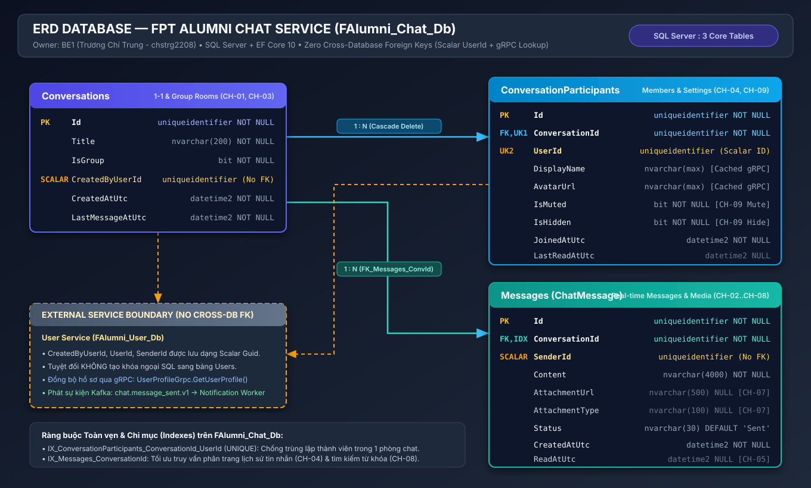

# FPT Alumni Connect — Chat Service (`f-alumni-chat-service`)

Dịch vụ Nhắn tin Thời gian thực (Real-time Messaging) thuộc hệ thống **FPT Alumni Connect** (PRN232 Final Assignment), được xây dựng theo chuẩn kiến trúc 3 tầng `.NET 10` (`Api -> Services -> Repositories`), SignalR WebSockets, gRPC Client (`UserProfileService`), và Kafka Producer (`chat.message_sent.v1`).

- **Owner**: Trương Chí Trung (`chstrg2208` — Backend 1)
- **Database**: `FAlumni_ChatService_Db` (Zero Cross-DB FK — lưu `UserId` dạng `Guid` thuần túy và tra cứu qua gRPC)
- **Tài liệu ERD Database**: [`docs/ERD.md`](docs/ERD.md) | [`docs/architecture/f-alumni-chat-db-erd.svg`](docs/architecture/f-alumni-chat-db-erd.svg) | [`docs/architecture/f-alumni-chat-db-erd.drawio`](docs/architecture/f-alumni-chat-db-erd.drawio)
- **Tài liệu Kiến trúc Hệ thống**: [`docs/ARCHITECTURE.md`](docs/ARCHITECTURE.md)

---

## 🗄️ Sơ Đồ ERD Cơ Sở Dữ Liệu (`FAlumni_Chat_Db`)



> Xem đặc tả chi tiết từng bảng, kiểu dữ liệu, khóa ngoại và chỉ mục tại [`docs/ERD.md`](docs/ERD.md).

---

## 🚀 Các User Stories Đã Hoàn Thành (Guideline & Google Sheet)

| Mã US | Tính năng | Endpoint / Hub |
|---|---|---|
| **CH-01** | Bắt đầu cuộc trò chuyện 1-1 hoặc Nhóm (Group Chat) | `POST /api/v1/chats/conversations` |
| **CH-02** | Gửi & nhận tin nhắn thời gian thực (SignalR + REST) | `POST /api/v1/chats/conversations/{id}/messages` & SignalR `/hubs/chat` (`SendMessage` / `ReceiveMessage`) |
| **CH-03** | Danh sách cuộc trò chuyện gần đây | `GET /api/v1/chats/conversations` |
| **CH-04 (Guideline)** | Tra cứu hồ sơ người tham gia qua **gRPC** (`UserProfileService`) | `GET /api/v1/chats/conversations/{conversationId}/participants/{userId}` |
| **CH-04 (Sheet)** | Lịch sử tin nhắn có phân trang (Pagination) | `GET /api/v1/chats/conversations/{id}/messages?page=1&pageSize=30` |
| **CH-05** | Trạng thái tin nhắn (`Sent` / `Read`) & Đánh dấu đã đọc | `POST /api/v1/chats/conversations/{id}/read` & SignalR `MarkConversationRead` / `MessagesRead` |
| **CH-06** | Hiển thị trạng thái đang nhập (`Typing...`) qua SignalR | SignalR `/hubs/chat` (`SendTypingIndicator` / `UserTyping`) |
| **CH-07** | Gửi hình ảnh / tệp đính kèm trong tin nhắn (`AttachmentUrl`, `AttachmentType`) | `POST /api/v1/chats/conversations/{id}/messages` |
| **CH-08** | Tìm kiếm tin nhắn theo từ khóa trong cuộc trò chuyện | `GET /api/v1/chats/conversations/{id}/messages?search=...` |
| **CH-09** | Tắt thông báo (`IsMuted`) hoặc Ẩn cuộc trò chuyện (`IsHidden`) | `PUT /api/v1/chats/conversations/{id}/settings` |
| **CH-10** | Phát sự kiện Kafka `chat.message_sent.v1` cho Push Notification | `ChatKafkaPublisher` (`EventEnvelope<ChatMessageSentEventPayload>`) |
| **Wake-up / Health** | Endpoint cho 60s Render Pinger Bot & Health Check | `GET /ping`, `GET /api/v1/ping`, `GET /health` |

---

## 🛠️ Chạy Kiểm Thử & Xác Minh Hợp Đồng

```powershell
.\scripts\verify-contracts.ps1
dotnet test ChatService.sln --configuration Release
```
