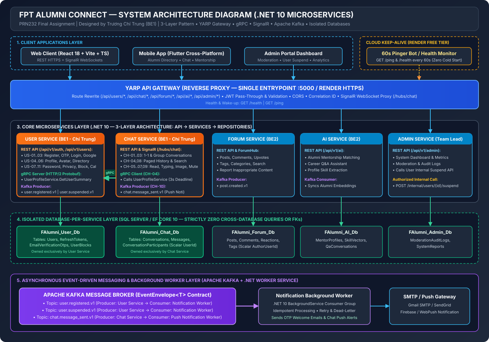
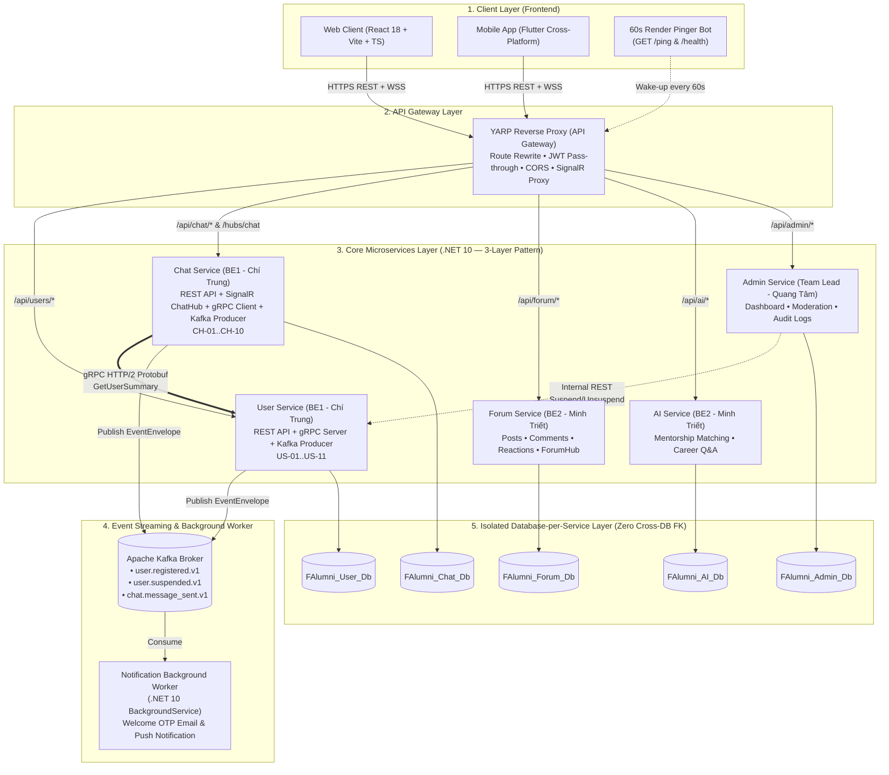
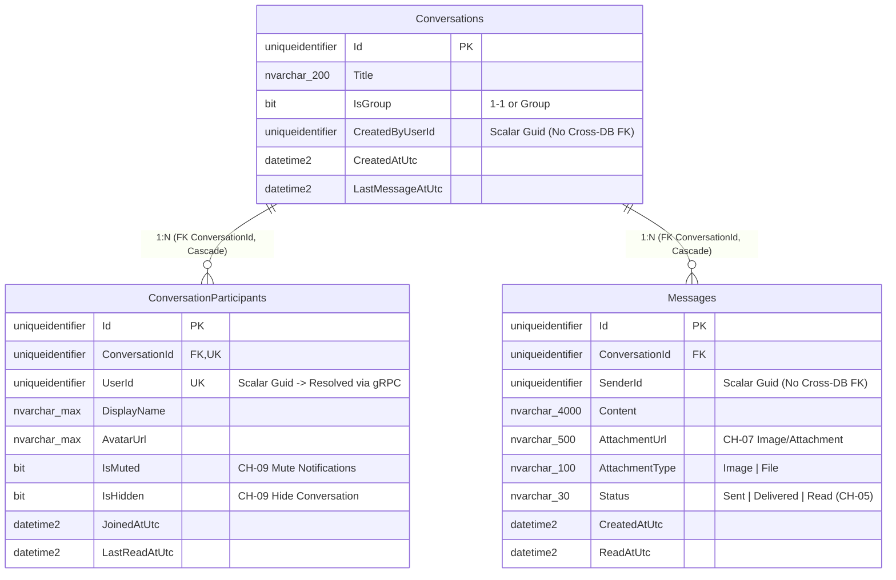
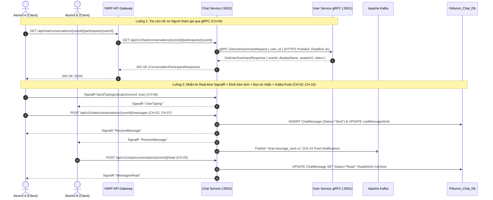

# 17. Sơ Đồ Kiến Trúc Hệ Thống Chi Tiết (System Architecture & ERD — BE1 Trương Chí Trung)

> **Người thực hiện**: Trương Chí Trung (`chstrg2208` — Backend 1)  
> **Phạm vi**:
> 1. Sơ đồ Kiến trúc Tổng thể Hệ thống (Vector SVG + Draw.io + Mermaid).
> 2. Kiến trúc 3 tầng nội bộ `.NET 10` (`Api -> Services -> Repositories`).
> 3. Sơ đồ ERD độc lập của `FAlumni_User_Db` (`f-alumni-user-service`) và `FAlumni_Chat_Db` (`f-alumni-chat-service`).
> 4. Sơ đồ Tuần tự (Sequence Diagrams) cho luồng **gRPC Profile Lookup**, **SignalR Real-time Messaging**, và **Apache Kafka Event Streaming**.
> 5. Sơ đồ Triển khai Cloud trên Render & Cơ chế **60s Pinger Bot** chống Cold-Start.

---

## 1. Sơ Đồ Kiến Trúc Tổng Thể (Vector SVG & Draw.io)

- **File Vector SVG**: [docs/architecture/f-alumni-architecture-overview.svg](architecture/f-alumni-architecture-overview.svg)
- **File Draw.io (Chỉnh sửa trực tiếp trên diagrams.net)**: [docs/architecture/f-alumni-system-architecture.drawio](architecture/f-alumni-system-architecture.drawio)

---

## 2. Sơ Đồ Kiến Trúc Tổng Thể (Mermaid Flowchart)

---

## 3. Sơ Đồ ERD Của `Chat Service` (`FAlumni_Chat_Db`) — Zero Cross-DB Foreign Keys

- **Tài liệu ERD chi tiết**: [docs/ERD.md](ERD.md)
- **File Vector SVG**: [docs/architecture/f-alumni-chat-db-erd.svg](architecture/f-alumni-chat-db-erd.svg)
- **File Draw.io**: [docs/architecture/f-alumni-chat-db-erd.drawio](architecture/f-alumni-chat-db-erd.drawio)

---

## 4. Luồng Tương Tác Đồng Bộ gRPC & Real-time SignalR (`Chat Service` $\leftrightarrow$ `User Service`)

