# Class Diagram — Chat Service (`f-alumni-chat-service`)

> **Thành viên thực hiện**: Trương Chí Trung (`chstrg2208` — Backend 1)  
> **Service**: `f-alumni-chat-service` (.NET 10 — 3-Layer Architecture + SignalR + gRPC Client + Kafka)  
> **File Draw.io (Trắng Đen Chuẩn UML)**: [`docs/architecture/f-alumni-chat-class-diagram.drawio`](architecture/f-alumni-chat-class-diagram.drawio)

---

## 1. Cấu Trúc 4 Tầng Trong Class Diagram (`Chat Service`)

1. **Tầng 1 — Presentation / REST API & Real-time SignalR Hub Layer (`ChatService.Api`)**:
   - `ChatsController`: Quản lý phòng trò chuyện 1-1/Group (`CreateConversation`, `GetConversations`, `GetConversationById`), tra cứu hồ sơ thành viên qua gRPC (`GetParticipantProfile`), phân trang/tìm kiếm tin nhắn (`GetMessages`), gửi tin nhắn (`SendMessage`), đánh dấu đã đọc (`MarkConversationRead`) và cài đặt tắt thông báo/ẩn hội thoại (`UpdateConversationSettings`).
   - `ChatHub : Hub` (`/hubs/chat`): Kết nối WebSocket thời gian thực cho phép vào/rời phòng (`JoinConversation`, `LeaveConversation`), gửi/nhận tin nhắn tức thì (`SendMessage` ➔ `ReceiveMessage`), chỉ báo đang gõ (`SendTypingIndicator` ➔ `UserTyping`) và đồng bộ trạng thái đã xem (`MarkConversationRead` ➔ `MessagesRead`).
2. **Tầng 2 — Business Logic / Application Services Layer (`ChatService.Services`)**:
   - `IChatAppService` / `ChatAppService`: Điều phối tạo hội thoại, lưu tin nhắn, cập nhật trạng thái đọc và gọi gRPC/Kafka.
   - `IUserProfileLookupService` / `UserProfileLookupService`: gRPC Client gọi đồng bộ sang `User Service` (`GetUserSummary`) qua HTTP/2 Protobuf với Deadline 3 giây.
   - `IChatKafkaPublisher` / `ChatKafkaPublisher`: Phát sự kiện `chat.message_sent.v1` lên Apache Kafka để kích hoạt Push Notification khi người nhận offline.
3. **Tầng 3 — Data Access / Repositories Layer (`ChatService.Repositories`)**:
   - `IChatRepository` / `ChatRepository`: Truy vấn EF Core bất đồng bộ trên `ChatServiceDbContext`.
   - `ChatServiceDbContext`: Quản lý 3 `DbSet` ánh xạ xuống `FAlumni_Chat_Db`.
4. **Tầng 4 — Domain Entities (`ChatService.Repositories.Entities` — Zero Cross-DB FK)**:
   - `Conversation`, `ConversationParticipant`, `ChatMessage`.

---

## 2. Sơ Đồ Class Diagram (Mermaid)

```mermaid
classDiagram
    direction TB

    class ChatsController {
        -IChatAppService _chatAppService
        -IUserProfileLookupService _profileLookupService
        -IHubContext~ChatHub~ _hubContext
        -IConfiguration _configuration
        +GetParticipantProfile(Guid convId, Guid userId) Task~IActionResult~
        +CreateConversation(CreateConversationRequest, Guid userId) Task~IActionResult~
        +GetConversations(Guid userId, bool includeHidden, int page, int pageSize) Task~IActionResult~
        +GetConversationById(Guid conversationId) Task~IActionResult~
        +GetMessages(Guid convId, string search, int page, int pageSize) Task~IActionResult~
        +SendMessage(Guid convId, SendMessageRequest, Guid userId) Task~IActionResult~
        +MarkConversationRead(Guid convId, MarkReadRequest) Task~IActionResult~
        +UpdateConversationSettings(Guid convId, UpdateConversationSettingsRequest) Task~IActionResult~
    }

    class ChatHub {
        -IChatAppService _chatAppService
        -ILogger~ChatHub~ _logger
        +OnConnectedAsync() Task
        +JoinConversation(Guid conversationId) Task
        +LeaveConversation(Guid conversationId) Task
        +SendMessage(Guid conversationId, SendMessageRequest) Task
        +SendTypingIndicator(Guid conversationId, bool isTyping) Task
        +MarkConversationRead(Guid conversationId) Task
        +GetConversationGroupName(Guid conversationId)$ string
    }

    class IChatAppService {
        <<interface>>
        +CreateOrGetConversationAsync(Guid creatorId, CreateConversationRequest) Task~ConversationResponse~
        +GetConversationByIdAsync(Guid conversationId) Task~ConversationResponse~
        +GetUserConversationsAsync(Guid userId, bool includeHidden, int page, int size) Task~PagedResponse~
        +SendMessageAsync(Guid convId, Guid senderId, SendMessageRequest) Task~ChatMessageResponse~
        +GetMessagesAsync(Guid convId, string search, int page, int size) Task~PagedResponse~
        +MarkConversationReadAsync(Guid convId, Guid readerId) Task~MarkReadResponse~
        +UpdateConversationSettingsAsync(Guid convId, Guid userId, UpdateConversationSettingsRequest) Task~ParticipantDto~
    }

    class ChatAppService {
        -IChatRepository _chatRepository
        -IUserProfileLookupService _profileLookupService
        -IChatKafkaPublisher _kafkaPublisher
    }

    class IUserProfileLookupService {
        <<interface>>
        +GetParticipantSummaryAsync(Guid convId, Guid userId, bool strictGrpc) Task~ConversationParticipantResponse~
    }

    class UserProfileLookupService {
        -UserProfileServiceClient _grpcClient
        -IConfiguration _configuration
        -ILogger~UserProfileLookupService~ _logger
    }

    class IChatKafkaPublisher {
        <<interface>>
        +PublishMessageSentAsync(ChatMessageResponse msg, IEnumerable~Guid~ recipientIds) Task
    }

    class ChatKafkaPublisher {
        -IConfiguration _configuration
        -ILogger~ChatKafkaPublisher~ _logger
    }

    class IChatRepository {
        <<interface>>
        +GetConversationByIdAsync(Guid conversationId) Task~Conversation~
        +GetDirectConversationAsync(Guid userAId, Guid userBId) Task~Conversation~
        +CreateConversationAsync(Conversation conversation) Task~Conversation~
        +GetUserConversationsAsync(Guid userId, bool includeHidden) Task~IReadOnlyList~Conversation~~
        +GetParticipantAsync(Guid conversationId, Guid userId) Task~ConversationParticipant~
        +UpdateParticipantAsync(ConversationParticipant participant) Task
        +AddMessageAsync(ChatMessage message) Task~ChatMessage~
        +GetMessagesPagedAsync(Guid convId, string search, int page, int size) Task~Tuple~
        +MarkMessagesAsReadAsync(Guid conversationId, Guid readerUserId) Task~int~
    }

    class ChatRepository {
        -ChatServiceDbContext _dbContext
    }

    class ChatServiceDbContext {
        +DbSet~Conversation~ Conversations
        +DbSet~ConversationParticipant~ ConversationParticipants
        +DbSet~ChatMessage~ Messages
    }

    class Conversation {
        +Guid Id
        +string Title
        +bool IsGroup
        +Guid CreatedByUserId
        +DateTime CreatedAtUtc
        +DateTime LastMessageAtUtc
    }

    class ConversationParticipant {
        +Guid Id
        +Guid ConversationId
        +Guid UserId
        +string DisplayName
        +string AvatarUrl
        +bool IsMuted
        +bool IsHidden
        +DateTime JoinedAtUtc
        +DateTime LastReadAtUtc
    }

    class ChatMessage {
        +Guid Id
        +Guid ConversationId
        +Guid SenderId
        +string Content
        +string AttachmentUrl
        +string AttachmentType
        +string Status
        +DateTime CreatedAtUtc
        +DateTime ReadAtUtc
    }

    ChatsController --> IChatAppService
    ChatsController --> IUserProfileLookupService
    ChatsController --> ChatHub
    ChatHub --> IChatAppService

    ChatAppService ..|> IChatAppService
    UserProfileLookupService ..|> IUserProfileLookupService
    ChatKafkaPublisher ..|> IChatKafkaPublisher
    ChatRepository ..|> IChatRepository

    ChatAppService --> IChatRepository
    ChatAppService --> IUserProfileLookupService
    ChatAppService --> IChatKafkaPublisher

    ChatRepository --> ChatServiceDbContext
    ChatServiceDbContext --> Conversation
    ChatServiceDbContext --> ConversationParticipant
    ChatServiceDbContext --> ChatMessage
    Conversation "1" --> "*" ConversationParticipant
    Conversation "1" --> "*" ChatMessage
```

