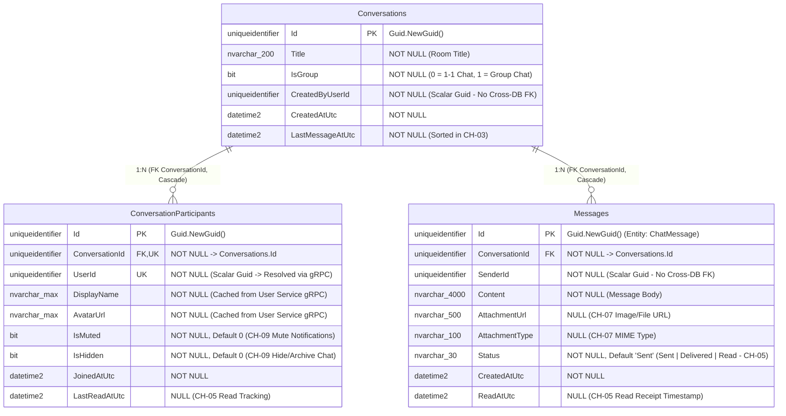

# 🗄️ Sơ Đồ ERD Cơ Sở Dữ Liệu — Chat Service (`FAlumni_Chat_Db`)

> **Service**: `f-alumni-chat-service`  
> **Người phụ trách**: Trương Chí Trung (`chstrg2208` — Backend 1)  
> **Cơ sở dữ liệu**: `FAlumni_Chat_Db` (SQL Server + EF Core 10)  
> **Nguyên tắc kiến trúc**: Database-per-Service — Tuyệt đối không tạo khóa ngoại liên cơ sở dữ liệu (Zero Cross-Database Foreign Keys). Mọi định danh người dùng (`CreatedByUserId`, `UserId`, `SenderId`) đều lưu dưới dạng `Scalar Guid` và đồng bộ hồ sơ qua **gRPC Client** (`user_profile.proto`).

---

## 1. Hình Ảnh Sơ Đồ ERD Trực Quan (SVG & Draw.io)

- **File Vector SVG**: [`docs/architecture/f-alumni-chat-db-erd.svg`](architecture/f-alumni-chat-db-erd.svg)
- **File Draw.io (Mở trên diagrams.net)**: [`docs/architecture/f-alumni-chat-db-erd.drawio`](architecture/f-alumni-chat-db-erd.drawio)

---

## 2. Sơ Đồ ERD Chuẩn Mermaid (`FAlumni_Chat_Db`)

---

## 3. Đặc Tả Chi Tiết Các Bảng & Ràng Buộc (Data Dictionary)

### 3.1. Bảng `Conversations` (Cuộc trò chuyện 1-1 & Nhóm — CH-01, CH-03)
- **Mục đích**: Quản lý phòng trò chuyện cá nhân (`IsGroup = false`) hoặc nhóm (`IsGroup = true`), sắp xếp danh sách cuộc trò chuyện gần đây theo `LastMessageAtUtc`.
- **Khóa & Ràng buộc**:
  - `PK_Conversations`: `Id` (`uniqueidentifier`).
  - `CreatedByUserId`: Lưu `Guid` thuần túy của người tạo phòng (không tạo Foreign Key sang database của User Service).

### 3.2. Bảng `ConversationParticipants` (Thành viên & Cài đặt — CH-04, CH-09)
- **Mục đích**: Lưu danh sách thành viên trong cuộc trò chuyện, thông tin hiển thị (`DisplayName`, `AvatarUrl` được đồng bộ qua **gRPC** `UserProfileGrpc.GetUserProfile`), và cài đặt cá nhân hóa (**CH-09**: `IsMuted` tắt thông báo, `IsHidden` ẩn cuộc trò chuyện).
- **Khóa & Chỉ mục**:
  - `PK_ConversationParticipants`: `Id` (`uniqueidentifier`).
  - `FK_ConversationParticipants_Conversations_ConversationId`: Quan hệ `N : 1` với `Conversations` (`OnDelete: Cascade`).
  - `IX_ConversationParticipants_ConversationId_UserId` (**Composite Unique Index**): Đảm bảo một `UserId` không thể tham gia trùng lặp 2 lần vào cùng một `ConversationId`.

### 3.3. Bảng `Messages` (`ChatMessage` Entity — CH-02, CH-04, CH-05, CH-07, CH-08)
- **Mục đích**: Lưu trữ toàn bộ tin nhắn thời gian thực qua SignalR `ChatHub` và REST API, hỗ trợ đính kèm hình ảnh/tệp (**CH-07**), trạng thái đã gửi/đã xem (**CH-05**), phân trang lịch sử (**CH-04**) và tìm kiếm theo từ khóa (**CH-08**).
- **Khóa & Chỉ mục**:
  - `PK_Messages`: `Id` (`uniqueidentifier`).
  - `FK_Messages_Conversations_ConversationId`: Quan hệ `N : 1` với `Conversations` (`OnDelete: Cascade`).
  - `IX_Messages_ConversationId`: Chỉ mục tăng tốc truy vấn lịch sử tin nhắn theo phòng chat.
  - `SenderId`: Lưu `Guid` thuần túy của người gửi (Zero Cross-DB FK).
