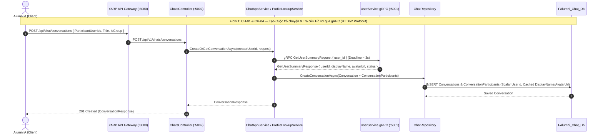
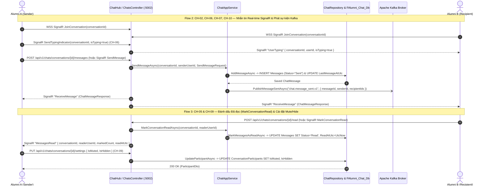

# Sequence Diagram — Chat Service (`f-alumni-chat-service`)

> **Thành viên thực hiện**: Trương Chí Trung (`chstrg2208` — Backend 1)  
> **Service**: `f-alumni-chat-service` (.NET 10 + SignalR + gRPC Client + Kafka)  
> **File Draw.io (Trắng Đen Chuẩn UML)**: [`docs/architecture/f-alumni-chat-sequence-diagram.drawio`](architecture/f-alumni-chat-sequence-diagram.drawio)

---

## 1. Luồng 1: Tạo Cuộc trò chuyện & Đồng bộ Hồ sơ Người tham gia qua gRPC HTTP/2 (`CH-01`, `CH-04`)

---

## 2. Luồng 2 & 3: Nhắn tin Real-time qua SignalR `ChatHub`, Typing Indicator, Kafka Push & Read Receipts (`CH-02..CH-10`)

